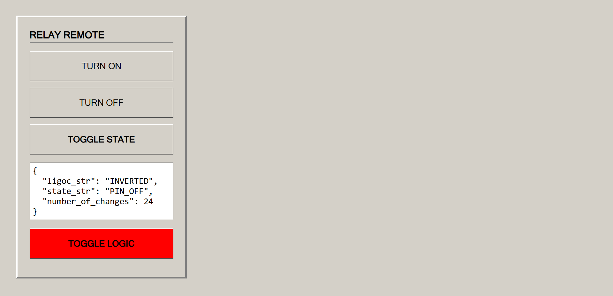

<!-- SPDX-License-Identifier: CC0-1.0 -->

# Relay Control

An example of controlling a relay via a web interface.

## Relay connection pins (Supports Low-Level trigger or High-Level trigger modules)
* `RELAY_PIN` -> GPIO 13
* `GND` -> Common ground

## API documentation
A full description of all available endpoints, JSON structure, and management commands is located in the [REST_API.md](./REST_API.md) file.